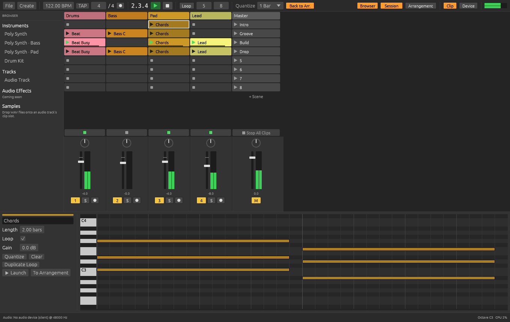
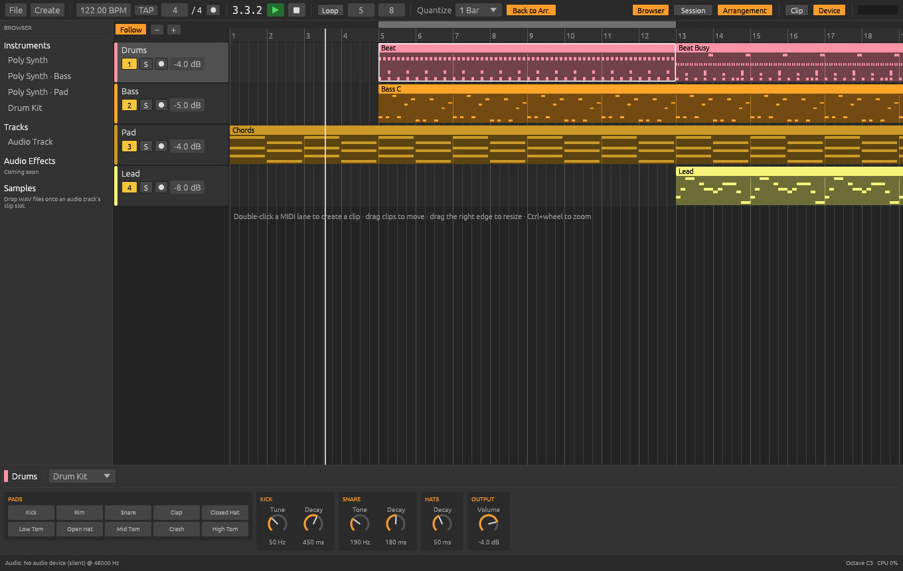
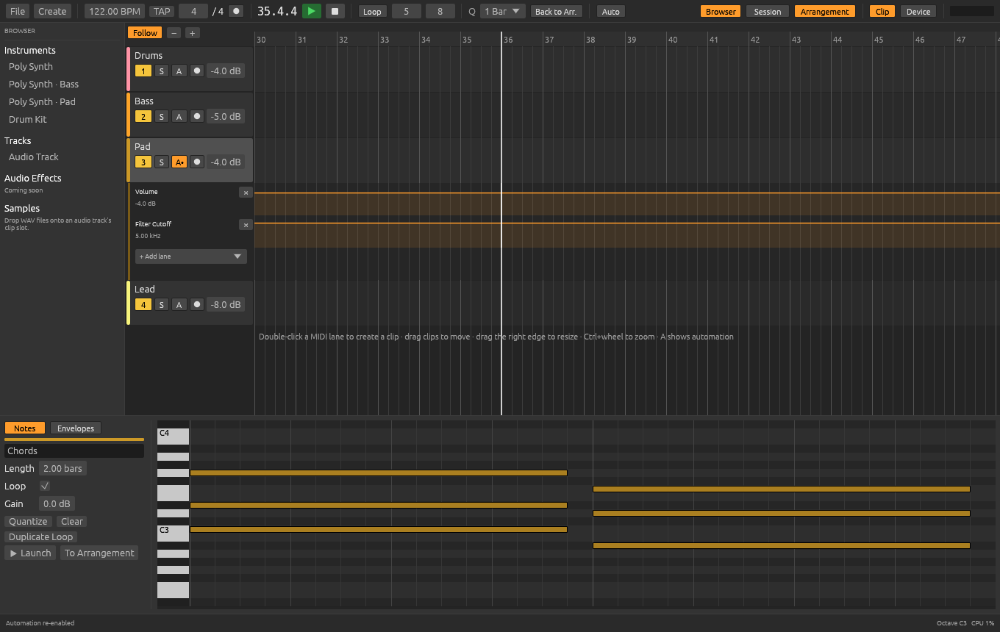
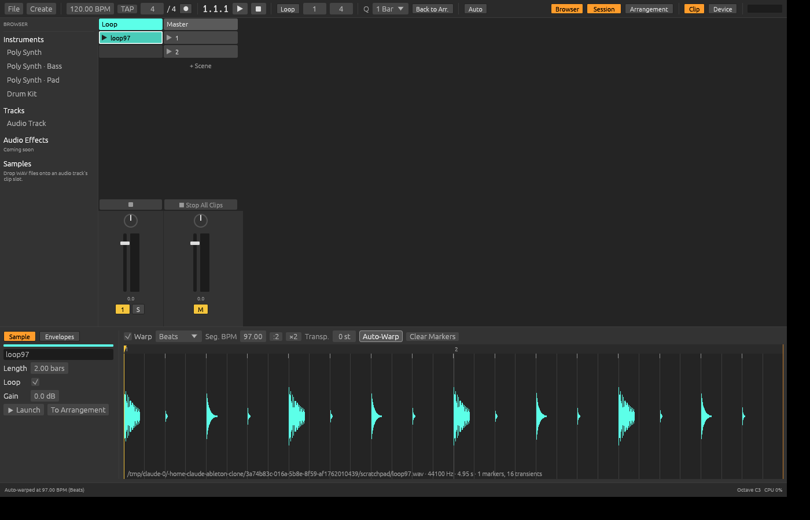
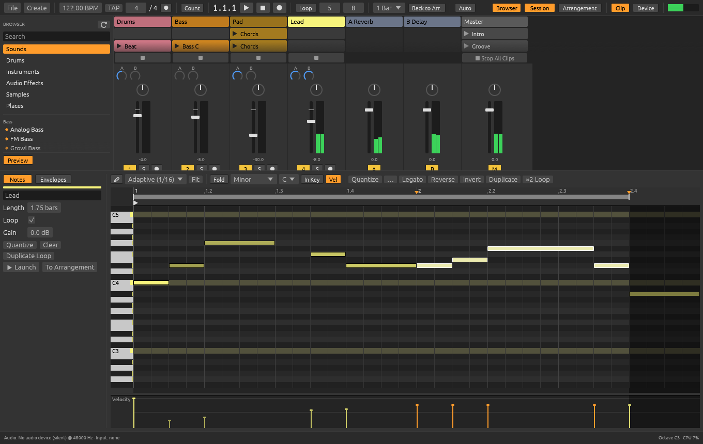
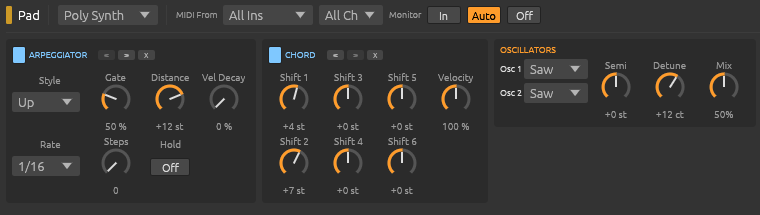
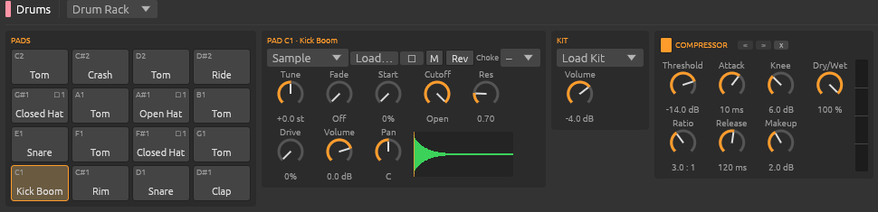
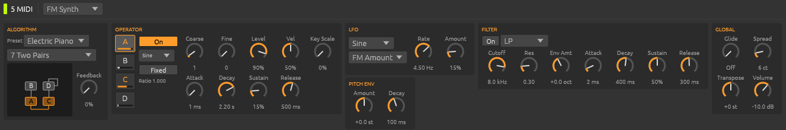
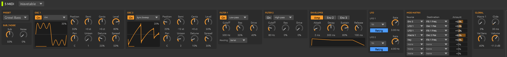

# Tessera

Tessera is an original, from-scratch digital audio workstation modelled on the
workflow of Ableton Live Suite: a Session view of launchable clips and scenes,
an Arrangement timeline, a mixer with return tracks, built-in instruments and
audio effects, a browser, audio recording and (on the roadmap) warping and
automation. All code in this repository is original.











> Status: **early**. The audio engine, transport, mixer with sends and
> returns, six built-in instruments, eight audio effects, the browser, audio
> recording, automation, warping, Session view and Arrangement view work. See
> the [roadmap](#roadmap) for what comes next.

## Features today

- **Real-time audio engine** written in Rust. The audio thread never allocates,
  frees or locks (enforced by a test with a counting allocator).
- **Transport**: play / stop / continue, tempo (20–999 BPM), time signature,
  start marker, arrangement loop, metronome.
- **Session view**: tracks × scenes grid of clip slots, quantized clip and scene
  launching (none, 1/32 … 8 bars), per-track stop buttons, Stop All Clips,
  optional per-scene tempo, Back to Arrangement.
- **Clip launch settings**: start, loop start and end markers; launch modes
  *Trigger*, *Gate* (plays while held), *Toggle* and *Repeat* (retriggers at
  the quantization while held); per-clip launch quantization; *Legato*
  (take over the replaced clip's position); and *Follow Actions* (Stop,
  Again, Previous, Next, First, Last, Any, Other) with A/B chance, a linked
  or custom follow time.
- **Arrangement view**: bar ruler, clips on a timeline, click to set the
  playhead, loop brace, drag clips to move them (snapped to the grid), zoom.
- **Mixer**: volume, pan (constant-power), mute, solo, arm, peak meters per
  track and on the master. **Return tracks** with post-fader **sends** (new
  projects start with *A Reverb* and *B Delay*).
- **Device chains**: every track, return track and the master has a chain of
  insert effects shown in the Device view after the instrument. Devices can
  be switched off, reordered, reset and deleted; parameter changes apply
  instantly and reverb/delay tails survive edits.
- **Audio effects**: *Parametric EQ* (8 bands: 12/48 dB cuts, shelves, bells,
  notch, with an interactive response curve), *Compressor* (soft knee,
  makeup, dry/wet, gain reduction meter), *Saturator* (soft clip, hard clip,
  tube, fold), *Chorus*, *Delay* (tempo sync, ping-pong, filtered feedback),
  *Reverb* (feedback delay network with pre-delay, decay, damping, width),
  *Limiter* (look-ahead brickwall, on the master by default) and *Utility*
  (gain, width, mono, phase).
- **Audio recording**: arm an audio track to monitor its input (Auto / In /
  Off, input 1/2, 1 or 2). Click the record button in an empty Session slot
  to record into it from the next launch boundary; launch the slot to stop
  and loop the new clip. *Arrangement Record* (F9) records armed tracks into
  the Arrangement from the playhead, with an optional count-in of 1, 2 or 4
  bars, punch in/out and a new take on every loop pass. Input latency is
  compensated; takes are saved as 32-bit float WAVs and collected into
  `Samples/Recorded` next to the project when it is saved.
- **MIDI recording**: arm a MIDI track and record from a hardware keyboard
  or the computer keyboard the same way, into a Session slot or the
  Arrangement. Notes played just ahead of a quantized start are kept.
- **MIDI effects** sit before the instrument on MIDI tracks: *Arpeggiator*
  (13 styles, synced rates, gate, steps and distance, hold, velocity decay),
  *Chord* (up to six shifted notes), *Scale* (snap to any of 14 scales and
  transpose), *Velocity* (curve, range, randomness), *Note Length* (fixed
  time or synced lengths, or play on release), *Pitch* (transpose with a
  note range filter) and *Random* (chance, choices, scale, sign).

  

- **MIDI controllers**: notes from hardware keyboards play the armed MIDI
  track, or the selected one when none is armed, with sustain pedal support.
  Each MIDI track picks its input port and channel and its monitor mode.
  *MIDI Map Mode* (Ctrl/Cmd + M) maps knobs, faders and pads to volume,
  pan, sends, mute/solo/arm, any device or instrument parameter, tempo,
  clips, scenes and play/stop, with min/max ranges.
- **Instruments**:
  - *Sampler*: plays one sample across the keyboard in *Classic* (with
    start/end and a held loop), *1-Shot* or *Slice* mode (slices by
    transients or 4/8/16/32 equal parts, one per key from C1), reverse,
    amp and filter envelopes, LP/HP/BP filter, 1–16 voices. Drag the
    markers on its waveform.
  - *Drum Rack*: 16 pads on C1–D#2 (the General MIDI drum layout), each with
    its own chain: a sample or a synthesized drum (kick, snare, clap, rim,
    hats, tom, crash, ride, cowbell, shaker), tune, decay/fade, start,
    reverse, filter, drive, volume, pan, mute and choke groups. Pads light
    up as they play; drop samples straight onto them. Kits: Standard, Boom,
    Tight, Lo-Fi.
  - *Wavetable*: two wavetable oscillators over 8 built-in band-limited
    tables (16 frames each) with position morphing and up to 8-voice
    unison, sub and noise, two filters (serial, parallel or split), three
    envelopes, two LFOs and an 8-slot modulation matrix.
  - *FM Synth*: four operators (sine and other waveforms, ratio or fixed
    frequency, own envelopes) in 11 algorithms with feedback, LFO, pitch
    envelope, filter, glide and stereo spread.
  - *Poly Synth* (2 oscillators, resonant filter with envelope) and the
    original synthesized *Drum Kit*.

  

  

  

  

- **Browser**: *Sounds* (instrument presets by type), *Drums* (kits and drum
  hits), *Instruments*, *Audio Effects*, *Samples* (a factory library of drum
  hits, loops and synth one-shots rendered by Tessera's own instruments on
  first start) and *Places* (your own folders, as a tree). Search, click a
  sample to preview it, and drag anything onto the app (see below).
- **Plug-ins**: hosts third-party **VST3** and **CLAP** instruments and
  effects (see [Plug-ins](#plug-ins) below).
- **Clip editing**: a piano roll for MIDI clips with multi-note selection
  (click, Shift-click, box select), draw mode, moving, resizing and
  copy-dragging on a fixed or adaptive grid (1/4 to 1/32, triplets), zoom and
  scroll, a ruler with the Start marker and a draggable loop brace, a
  velocity lane, quantize with strength and swing, note stretch, legato,
  reverse, invert, duplicate, copy and paste, Fold, and a per-clip scale with
  *Fold to scale*. Audio clips open in the sample editor (see Warping).
- **Audio clips**: drop a WAV file from the browser or your desktop onto a
  slot of an audio track or onto the Arrangement.
- **Automation**: breakpoint envelopes with curves for volume, pan and every
  instrument parameter, as Arrangement automation lanes and as clip envelopes
  that loop with Session clips. Automation Arm records control moves while
  playing; moving an automated control by hand overrides it until
  *Re-Enable* is clicked. Mixer automation is applied every sample.
- **Warping**: audio clips follow the project tempo through warp markers, with
  *Beats* (transient slicing), *Tones* (granular), *Complex* (WSOLA) and
  *Re-Pitch* modes, clip transpose, and transient detection plus tempo
  estimation for *Auto-Warp*. WAV files of 2 seconds or more are auto-warped
  when dropped or imported.
- **Projects**: save and open as JSON (`.tessera`). A demo song loads on start.
- **Offline export** of the arrangement to WAV (`tessera render`).
- **Undo and redo** for every edit (Ctrl/Cmd + Z, Ctrl/Cmd + Shift + Z), with
  a *History* panel (Edit > History) that jumps to any step. A drag is one
  step.
- **Tracks**: *Group Tracks* (Ctrl/Cmd + G) folds tracks into a group with
  its own mixer and devices; groups nest, fold and launch their members'
  clips together. Rename, colour, duplicate, delete and reorder tracks;
  *Freeze* renders a track to audio (saving CPU) and *Flatten* turns the
  frozen audio into clips. *Audio From* takes another track's output as an
  input (resampling, sidechain-style routing), *Track Delay* shifts a track
  by ±100 ms, and each track can be assigned to the *A* or *B* side of the
  master **crossfader**. *Cue* sends pre-fader solo to outputs 3/4 with its
  own volume when the audio device has four outputs.
- **Arrangement editing**: drag a time selection, then *Split* (Ctrl/Cmd +
  E), *Consolidate* (Ctrl/Cmd + J; MIDI is merged, audio is rendered),
  *Delete*, *Reverse*, clip fade handles and crossfades between neighbouring
  clips. **Locators** on the ruler (with previous/next buttons in the
  transport), **time signature changes**, and a **Song Tempo** lane on the
  master for tempo automation (Edit > Song Tempo Lane; changing the tempo by
  hand overrides it until *Tempo* re-enables it). Drag clips between the
  Session and the Arrangement in both directions.
- **Take lanes and comping**: every Arrangement recording is also kept as a
  take lane; drag across a take to copy that part onto the track (audio and
  MIDI). *Punch In / Out* records only inside the loop brace, and *OVR*
  (MIDI Arrangement Overdub) adds new notes to the ones already there.
- **Session workflow**: scenes with their own tempo and time signature,
  scene *Follow Actions* (next, previous, first, last, any, other, again,
  stop after a set number of beats), *Capture and Insert Scene* (Ctrl/Cmd +
  Shift + I), *Session Record* (+Rec: armed tracks record into the selected
  scene, adding scenes as needed), and removable stop buttons in empty
  slots.
- **Capture MIDI** (Ctrl/Cmd + Shift + C): turns what you just played on a
  MIDI track into a clip, even with the transport stopped (the tempo is
  then set from your playing).
- **Groove Pool**: preset grooves (swung 8ths and 16ths, shuffle, push, lazy)
  and grooves extracted from any clip; each MIDI clip can play with a groove
  (quantize, timing, random and velocity amounts, global amount up to 130%)
  and *Commit* writes it into the notes.
- **Audio to MIDI**: right-click an audio clip in the Arrangement to convert
  its melody, harmony or drums to a new MIDI track, or *Slice to New MIDI
  Track* (a Sampler in slice mode with a clip that plays the slices).

## Building and running

You need a recent stable Rust toolchain (install from <https://rustup.rs>).

### macOS / Windows

```sh
cargo run --release
```

### Linux

Install the ALSA and windowing development packages first. On Debian/Ubuntu:

```sh
sudo apt install build-essential pkg-config libasound2-dev libxkbcommon-dev \
    libx11-dev libxcursor-dev libxrandr-dev libxi-dev libgl1-mesa-dev
cargo run --release
```

### Command line

```sh
tessera                      # open the app with the demo song
tessera path/to/song.tessera # open a project
tessera --play --arrangement # start playing, showing the Arrangement
tessera render out.wav [beats] [project.tessera]
                             # render the arrangement to a WAV file
```

When no audio output device is available the app keeps running on a silent
"null" device so the UI and transport still work.

### Tests

```sh
cargo test --workspace
```

## Using it

| Key | Action |
| --- | --- |
| Space | Play / Stop |
| F9 | Arrangement Record |
| Shift + Space | Continue from the stop position |
| Tab | Switch between Session and Arrangement view |
| Shift + Tab | Switch the detail panel between Clip and Device |
| Ctrl/Cmd + S / O / N | Save / Open / New |
| Delete | Delete the selected notes, the time selection, or the selected clip |
| Ctrl/Cmd + Z, Ctrl/Cmd + Shift + Z (or Y) | Undo / redo |
| Ctrl/Cmd + Alt + Z | History panel |
| Ctrl/Cmd + G, Ctrl/Cmd + Shift + G | Group the selected tracks / ungroup |
| Ctrl/Cmd + E | Split clips at the time selection or playhead |
| Ctrl/Cmd + J (Arrangement) | Consolidate the time selection or clip |
| Ctrl/Cmd + Shift + I | Capture and Insert Scene |
| Ctrl/Cmd + Shift + C | Capture MIDI |
| B | Piano roll: toggle draw mode |
| Ctrl/Cmd + A, Esc | Piano roll: select all notes / deselect |
| Up / Down (+ Shift) | Transpose selected notes by a semitone (an octave) |
| Left / Right | Move selected notes by the grid |
| Shift + Left / Right | Shorten / lengthen selected notes by the grid |
| Ctrl/Cmd + D | Duplicate the selected notes (or the selected clip) |
| Ctrl/Cmd + C / X / V | Copy / cut / paste notes |
| Ctrl/Cmd + J | Legato (selected notes, or all) |
| Ctrl/Cmd + U, Ctrl/Cmd + Shift + U | Quantize / quantize settings |
| Ctrl/Cmd + 1 / 2 | Narrower / wider grid |
| A S D F G H J K (W E T Y U) | Play the selected track's instrument |
| Z / X | Octave down / up for the computer keyboard |
| Ctrl/Cmd + M | MIDI Map Mode on / off (Esc leaves it) |
| Ctrl/Cmd + , | MIDI Settings |

- Click a slot's ▶ triangle (or double-click the clip) to launch it; click a
  scene's ▶ on the master column to launch the whole row.
- Double-click an empty MIDI slot to create a clip; the piano roll opens below.
  Right-click a slot or a scene for more options (duplicate, delete, rename,
  scene tempo, *Add to Arrangement*).
- **Piano roll**: click a note to select (and hear) it, Shift- or Ctrl-click
  to add notes to the selection, and drag on empty space to box-select.
  Double-click empty space to add a note of the grid length; double-click or
  right-click a note to delete it. In draw mode (B, or the pencil) click or
  drag across a row to paint notes and click a note to delete it. Drag
  selected notes to move them (snapped to the grid; press Alt during the drag
  to move freely), drag a note's right edge to resize the selection, and
  Alt- or Ctrl-drag to move a copy. The plain wheel scrolls pitch,
  Shift + wheel scrolls time and Ctrl/Cmd + wheel zooms; *Fit* (or a
  double-click on the ruler) shows the whole clip. In the ruler drag the
  Start flag, the loop brace or its edges (the loop end is the clip length;
  the End flag when the clip does not loop); with two or more notes selected,
  drag the orange stretch handles to scale them in time. In the velocity
  lane drag a stem (all selected stems move together) or drag across empty
  space to draw velocities. Ctrl/Cmd + V pastes after the copied notes, or
  where you last clicked empty grid space. Pick a scale in the toolbar to
  darken rows outside it; *In Key* folds to the scale, *Fold* to the rows
  with notes.
- In the Arrangement, click the ruler or a lane to move the playhead, drag clips
  to move them (hold Alt to bypass the grid), drag a clip's right edge to
  resize it, double-click an empty MIDI lane to create a clip, and drag or
  double-click the loop brace above the ruler. Ctrl/Cmd + mouse wheel zooms.
- **Automation**: click a track's **A** button in the Arrangement to open its
  automation lanes and pick parameters with *+ Add lane*. In a lane, click to
  add a breakpoint, drag points to move them (Alt bypasses the grid), drag a
  line to move a segment, Alt + drag a line to curve it, and double-click or
  right-click a point to delete it. Clip envelopes are on the clip view's
  *Envelopes* tab. Turn on **Auto** in the transport bar and move a fader or
  knob while playing to record automation (into the playing Session clip, or
  the Arrangement).
- **Warping**: select an audio clip to open the sample editor. Toggle *Warp*,
  choose the mode, set the clip tempo (*Seg. BPM*, :2 / ×2) and transpose, or
  click *Auto-Warp*. Double-click the waveform to add a warp marker (it snaps
  to nearby transients), drag markers to stretch the audio, and double-click
  or right-click a marker to remove it.
- Drag from the browser: an instrument or sound onto a MIDI track replaces
  its instrument (onto empty space it makes a new track); an effect onto any
  track, return or the master adds it to the chain; a sample onto an audio
  track's slot or Arrangement lane makes a clip, onto a MIDI track loads it
  into its Sampler or the selected Drum Rack pad (other instruments are
  replaced by a Sampler), and onto empty space makes a new audio track.
  Double-click an item to load it on the selected track. Right-click a
  folder for *Create Drum Rack from folder*; add your own folders under
  *Places*. Tessera keeps its settings and factory samples in
  `~/.local/share/tessera` (Linux), `~/Library/Application Support/Tessera`
  (macOS) or `%APPDATA%\Tessera` (Windows). The *Device* view (Shift + Tab)
  shows the selected track's instrument and effects; click a return track's
  or the master's header to see theirs. In the EQ, drag a numbered point to
  move a band, scroll over it to change its Q and double-click to switch it
  on or off.
- **Clip launch**: select a Session clip to see its *Markers*, *Launch* and
  *Follow Action* settings on the left of the clip view. For example, set
  every clip in a column to Follow Action *Any* and the track keeps picking
  a random next clip.
- **MIDI effects**: on a MIDI track's Device view, click *+ MIDI Effect*. The
  *MIDI From* menus next to it choose the input port and channel.
- **MIDI controllers**: plug a controller in and open *File > MIDI Settings*
  (or right-click the **MIDI** button, top right) to see your ports. *Track*
  lets a port play notes, *Remote* lets it control mappings. To map, press
  Ctrl/Cmd + M, move a control on screen (or click a clip or scene), then
  move a knob or press a pad. Mappings are saved with the project and can
  be edited or deleted in MIDI Settings.
- Send knobs (A, B, …) sit above each track's pan knob. Right-click the
  master or a return header to add or delete return tracks.

## Plug-ins

Tessera loads VST3 (`.vst3`) and CLAP (`.clap`) plug-ins, both instruments
and audio effects.

- **Finding them.** On start Tessera scans the standard folders in the
  background (only new or changed files are scanned again):
  - Windows: `C:\Program Files\Common Files\VST3` and `...\CLAP`, plus
    `%LOCALAPPDATA%\Programs\Common\VST3` and `...\CLAP`.
  - macOS: `/Library/Audio/Plug-Ins/VST3` and `.../CLAP`, plus the same
    under `~/Library`.
  - Linux: `~/.vst3`, `~/.clap`, `/usr/lib/vst3`, `/usr/lib/clap`,
    `/usr/local/lib/vst3` and `/usr/local/lib/clap`.
  - Anything in `VST3_PATH` or `CLAP_PATH`, and folders you add with
    **+ Add Folder…** under *Plug-Ins* in the Browser.
- **Using them.** Open *Plug-Ins* in the Browser and drag a plug-in onto a
  track, or double-click it. Instruments also show up in a MIDI track's
  instrument menu, and effects under **+ Add Effect → Plug-Ins** in the
  Device view. The Device view shows the plug-in's parameters as sliders.
  **Edit** opens the plug-in's own window. Changes made in either place show
  up in the other.
- **Saving.** Each plug-in's own state is saved inside the `.tessera`
  project. If a project uses a plug-in that isn't installed, the device
  says so and keeps the saved state, so nothing is lost when you save.
- **Crash protection.** Every plug-in instance runs in its own small
  process. If a plug-in crashes, only that process dies: Tessera keeps
  playing, the plug-in is bypassed, and **Reload** in its device starts it
  again. If a plug-in is too slow for a block, that block is skipped
  instead of stalling the whole engine.
- **Export** runs fresh copies of the project's plug-ins offline, so the
  plug-ins you are playing live aren't disturbed.
- **VST2 is not supported.** Steinberg stopped licensing the VST2 SDK to
  new hosts in 2018, so Tessera can't legally load VST2 (`.dll`/`.vst`)
  plug-ins. Nearly every current plug-in also ships as VST3 or CLAP;
  install that version instead.

Plug-in support is built from original code on the permissively licensed
[`vst3`](https://crates.io/crates/vst3) and
[`clap-sys`](https://crates.io/crates/clap-sys) bindings; no Steinberg SDK
code is included.

## Architecture

```
crates/
  engine/   tessera-engine: project model, real-time engine, DSP, offline render
    src/model.rs      serialisable project (tracks, clips, scenes, mixer)
    src/engine.rs     audio thread: transport, session/arrangement playback, mixer
    src/automation.rs envelopes, parameter ranges, per-track automation buffers
    src/warp.rs       warp markers and the Beats/Tones/Complex/Re-Pitch modes
    src/analysis.rs   transient detection, tempo estimation, auto-warp
    src/engine/buses.rs   return tracks and sends
    src/engine/record.rs  audio input, monitoring, recording takes, count-in
    src/dsp/          instruments (Sampler, Drum Rack, Wavetable, FM Synth, Poly
                      Synth, Drum Kit), ADSR, state-variable filter
    src/library.rs    browser presets, kits and the factory sample library
    src/engine/preview.rs  browser sample preview
    src/fx/           audio effects and device chains (FxChain)
    src/render.rs     offline export
    src/demo.rs       built-in demo song
    src/plugin.rs     plug-in slots and the registry of real-time processors
  plugin-host/  tessera-plugin-host: sandboxed VST3/CLAP hosting
    src/client.rs     Tessera's side: starts a bridge, real-time Processor
    src/bridge/       the bridge process: CLAP and VST3 adapters, editor window
    src/shm.rs, src/signal.rs  shared audio memory and cross-process wake-ups
    src/scan.rs       plug-in folders, scanning (one process per file), cache
  test-plugin/  a tiny VST3 + CLAP plug-in used by the host's tests
  app/      tessera: desktop application (egui + cpal)
    src/audio.rs      audio device input/output (cpal) and null fallback device
    src/app.rs        application state, commands, keyboard shortcuts
    src/devices.rs    editing device chains, sends and return tracks
    src/browser.rs    browser state, places, preview and drag-and-drop actions
    src/plugins.rs    scanning, plug-in instances per slot, state, export
    src/recording.rs  turns recorded input into clips and WAV files
    src/ui/           transport bar, Session view, Arrangement view, mixer,
                      detail view (piano roll, devices), widgets
```

**Why Rust + egui.** A DAW needs a hard real-time audio thread, so the engine is
written in Rust: native speed, no garbage collector, and the type system makes
it practical to keep the audio thread free of locks and allocations. The UI is
built with [egui](https://github.com/emilk/egui), an immediate-mode GUI that
redraws at the display's refresh rate. That suits a DAW (playheads, meters and
clip progress animate constantly, and the timeline, clip grid and piano roll are
custom-drawn) and keeps everything in one language and one native binary on
macOS, Windows and Linux, without a browser layer between the UI and the
engine. Audio I/O uses [cpal](https://github.com/RustAudio/cpal) (CoreAudio,
WASAPI, ALSA; JACK later).

**Engine / UI split.** The UI owns the project document. When its structure
changes it is compiled into an immutable snapshot and sent to the audio thread
through a lock-free ring buffer; the audio thread moves live voice and clip
state from the old snapshot into the new one and hands the old one back to the
UI to free. Small, frequent edits (faders, launches, transport) are individual
commands. The engine publishes playhead, meters and clip states through atomics.

**Effects.** Each effect's settings are a plain `Copy` struct of `f32`
parameters described by a static table (name, range, scale, unit), so the
Device view draws generic controls and single parameters can be set by index
(the hook automation will use). DSP state (delay lines, envelopes) is
allocated on the UI thread when a snapshot is compiled and moved from the old
snapshot to the new one by device id.

**Instruments.** An instrument's settings are a plain `Copy` value sent to
the audio thread as is. Samples for the Sampler and Drum Rack live next to it
in the track (`Track::samples`) and reach the engine inside the project
snapshot, so loading a sample is a snapshot swap and the old sample is freed
on the UI thread. The Wavetable bank and FM waveforms are built once, on the
UI thread, and shared.

**Recording.** The input device writes into a lock-free ring the engine reads
each block. While anything records, the engine streams the raw input to the
UI through a second ring together with sample-accurate start/stop events, so
the audio thread never grows a buffer. The UI cuts the takes out of that
stream, drops the measured input + output latency from the front, writes the
WAV files and adds the clips.

**Plug-ins.** Each plug-in instance runs in a bridge process: Tessera itself
started with `--plugin-bridge`. The engine's audio thread writes one block
(audio, notes, parameter changes, transport) into memory shared with the
bridge, wakes it with a pipe (Unix) or a named event (Windows), and waits a
bounded time for the result. It never allocates or takes a lock around a
plug-in. A late block is skipped, and a dead bridge (pipe closed) means
bypass. Control messages (load, state, parameters, editor) travel as JSON
lines over the bridge's stdin and stdout. The bridge runs the plug-in's
editor in its own native window, using winit.

**Time.** All positions are stored in beats so projects survive tempo changes.
Session clips follow a monotonic session clock (so they keep playing straight
through arrangement loop jumps); the arrangement follows the song position.
Events are scheduled sample-accurately inside each audio block.

## Roadmap

Planned follow-up work, roughly in order:

1. **Recording** (audio and MIDI recording, count-in, Session slot recording
   hardware MIDI input, punch in/out, MIDI overdub, Capture MIDI and take
   lanes with comping are done): record quantization, input device
   selection, record Session performance into the Arrangement.
2. **Effects and device chains** (EQ, compressor, reverb, delay, chorus,
   saturator, limiter, utility, returns and sends are done): glue-style bus
   compressor, auto filter, gate, sidechain inputs, pre-fader sends, drag and
   drop reordering, racks with macros, plugin delay compensation.
3. **Automation** (lanes, clip envelopes, recording and overrides for the
   mixer and every instrument are done): send and effect-parameter lanes,
   parameter modulation, automation in Session-to-Arrangement recording.
4. **Warping and audio editing** (warp markers, four warp modes, transient
   detection, auto-warp, reverse, consolidate, fades and audio-to-MIDI are
   done): a formant-preserving mode, clip start offset.
5. **MIDI editing** (piano roll tools, launch modes, follow actions and seven
   MIDI effects are done): note echo, MIDI effect racks, MPE.
6. **More instruments** (Sampler, Drum Rack, Wavetable and FM Synth are
   done): multisample zones, user wavetables, instrument racks, saving your
   own presets, physical-model-style instruments.
7. **Browser** (categories, places, search, preview and drag and drop are
   done): clips and project files, previewing presets, tags and
   collections, file formats beyond WAV (FLAC, MP3, AIFF, OGG).
8. **Plugins** (VST3 and CLAP hosting, sandboxing and editors are done):
   plugin delay compensation, sidechain and multi-output plug-ins, MIDI
   output from plug-ins, plug-in presets in the browser.
9. **Project features** (undo/redo with history, groups, freeze/flatten,
   track delay, tempo automation, time signature changes, locators, Groove
   Pool are done): collect-all-and-save, templates.
10. **Performance and I/O**: multi-core track processing, JACK/ASIO,
    plugin delay compensation, Link-style tempo sync, MIDI clock and
    controller scripts.
11. **Export**: stems, sample-rate/bit-depth options, MP3/FLAC export.

## License

MIT
